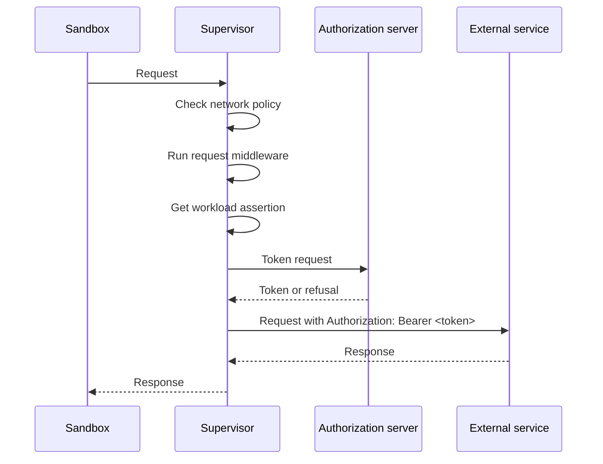

A delegated credential grant hands credential decisions to an OAuth 2.0 authorization server that you run. For each HTTPS request to a selected host, the sandbox supervisor asks the authorization server for a token and sends the request with that token. The authorization server decides whether the sandbox can call the host and which credential it gets.

## When to Use a Delegated Grant

Provider credentials are stored by the gateway and delivered to the sandbox. Use a delegated grant when an external system needs to make the decision for every request instead. For example, you can:

- Revoke a sandbox's access to an API, and have the next request fail.
- Rotate upstream credentials without changing the gateway or the sandbox.
- Exchange the token of the user an agent acts for, so the upstream API sees that user.
- Add an API the authorization server issues tokens for without a gateway change.

The supervisor requests a new token for every request and does not cache tokens. The authorization server owns caching.

## How a Delegated Grant Processes Traffic

The supervisor requests the token after it checks network policy and runs request middleware:



The supervisor authenticates to the authorization server with a workload assertion: a JWT that identifies the sandbox. It gets the assertion again for every token request. The supervisor then replaces every `Authorization` header on the request with `Bearer <token>`. Middleware never sees the token, because it runs first and cannot read or write `Authorization`.

A delegated grant applies only to HTTPS traffic that OpenShell inspects. The supervisor never sends a delegated token over plaintext HTTP. It refuses connections to a selected host that OpenShell does not parse as HTTP, such as an endpoint with `tls: skip`.

## Workload Assertions

`assertion_source` selects where the assertion comes from. The authorization server must trust its issuer.

### SPIFFE

With `spiffe`, the supervisor fetches a JWT-SVID from the sandbox's SPIFFE Workload API. The deployment must run a SPIFFE Workload API for sandboxes. `assertion_audience` sets the JWT-SVID `aud`.

### File

With `file`, the platform that runs the sandbox obtains a JWT and writes it to `assertion_file`. Any OIDC issuer the authorization server trusts works, such as an AWS STS `GetWebIdentityToken` result.

The supervisor reads the file on every token request, so replace the file before the JWT expires. The supervisor checks that the file holds a JWT with an `exp` claim that has not passed. A missing, unreadable, or expired file fails the request with HTTP 502. The authorization server verifies the signature.

Mount the file where the supervisor can read it and the agent cannot.

### Kubernetes Service Account Tokens

On Kubernetes, the driver can supply the file. Set the Kubernetes driver's `delegated_grant_token_audience` to the audience the authorization server expects:

```toml
[openshell.drivers.kubernetes]
delegated_grant_token_audience = "https://auth.example.com"

[openshell.supervisor.delegated_grant]
token_endpoint = "https://auth.example.com/oauth/token"
assertion_source = "file"
assertion_file = "/var/run/secrets/openshell/delegated-grant-token"
include_hosts = ["api.github.com"]
```

The kubelet writes a service account token for that audience into each supervisor pod and replaces it before it expires. The token lifetime is the driver's `sa_token_ttl_secs`. The agent's pod does not get the token.

The authorization server must trust the cluster's service account issuer. The token's `sub` is the namespace's service account. Its `kubernetes.io.pod.name` claim is the supervisor pod, `os-supervisor-<sandbox-id>`, which identifies the sandbox.

## Grant Types

`client_credentials` is the default. The sandbox acts as itself, and the authorization server decides based on the sandbox's identity and the requested resource.

`token_exchange` uses RFC 8693 token exchange. The workload sends a user-delegated bearer token in `Authorization`. The supervisor sends that token to the authorization server as `subject_token` and replaces it with the token the server returns. Each request must have exactly one `Authorization: Bearer` header.

## Token Request

The supervisor sends a `POST` to the token endpoint with an `application/x-www-form-urlencoded` body:

| Parameter | Value |
|---|---|
| `grant_type` | `client_credentials`, or `urn:ietf:params:oauth:grant-type:token-exchange`. |
| `client_assertion_type` | `urn:ietf:params:oauth:client-assertion-type:jwt-bearer` unless configured. |
| `client_assertion` | The workload assertion. |
| `client_id` | The configured `client_id`, as RFC 7521 allows. Omitted when not configured. |
| `resource` | The RFC 8707 resource indicator: the request origin, such as `https://api.github.com` or `https://api.example.com:8443`. The default port is left out. |
| `scope` | The configured scopes, separated by spaces. Omitted when none are configured. |
| `subject_token` | Token exchange only. The workload's bearer token. |
| `subject_token_type` | Token exchange only. `urn:ietf:params:oauth:token-type:access_token` unless configured. |
| `requested_token_type` | Token exchange only. `urn:ietf:params:oauth:token-type:access_token`. |

The request also has an `x-openshell-request-id` header. The workload receives the same ID on a refused request, so you can match the authorization server's log entry to the failure.

The authorization server returns a standard OAuth 2.0 token response. The `access_token` must be a valid bearer token value (RFC 6750 `token68` syntax).

## Refusals and Failures

The supervisor answers the workload with HTTP 403 when the token endpoint uses `https://` and returns HTTP 400, 401, or 403 with one of these OAuth `error` values:

- `access_denied`
- `invalid_target`
- `unauthorized_client`
- `invalid_grant`
- `insufficient_authorization`

The supervisor also answers with HTTP 403 when a `token_exchange` request does not have exactly one `Authorization: Bearer` header, or when the request is plaintext HTTP.

Any other failure returns HTTP 502, including an unavailable token endpoint or an invalid token response. The supervisor does not forward the request in either case. Both responses include the `x-openshell-request-id` header and do not state the cause.

The grant fails closed. If the supervisor rejects the grant configuration that the gateway sends, it refuses every request and every uninspected connection until it installs a valid grant.

## Configure a Delegated Grant

Configure one delegated grant per gateway in `[openshell.supervisor.delegated_grant]`:

```toml
[openshell.supervisor.delegated_grant]
token_endpoint = "https://auth.example.com/oauth/token"
assertion_source = "spiffe"
grant_type = "token_exchange"
include_hosts = ["api.github.com", "**.example.com"]
exclude_hosts = ["status.example.com"]
```

| Field | Required | Behavior |
|---|---|---|
| `token_endpoint` | Yes | Token endpoint URL. Use `https://` unless the endpoint is loopback or a Kubernetes service. |
| `assertion_source` | Yes | `spiffe` presents the sandbox's JWT-SVID. `file` presents the JWT in `assertion_file`. |
| `assertion_file` | For `file` | Absolute path, in the supervisor's file system, of a file that holds one JWT. Not allowed with `spiffe`. |
| `assertion_audience` | No | `aud` of the JWT-SVID for `spiffe`. Defaults to `token_endpoint`. When the path contains `/realms/<realm>/`, the default is the URL up to the realm. Not allowed with `file`. |
| `client_id` | No | OAuth 2.0 `client_id` sent with the assertion. Set it when the authorization server looks up the client by ID instead of by the assertion's subject. Must not contain whitespace. |
| `client_assertion_type` | No | OAuth 2.0 `client_assertion_type`. |
| `grant_type` | No | `client_credentials` (default) or `token_exchange`. |
| `subject_token_type` | No | `subject_token_type` for `token_exchange`. |
| `include_hosts` | Yes | Host patterns that use the grant, with network policy host syntax. |
| `exclude_hosts` | No | Host patterns removed from `include_hosts`. |
| `scopes` | No | Scopes sent with every token request. |

Network policy still applies. A selected host must also be allowed by the sandbox's network policy.

The delegated grant owns `Authorization` on selected hosts. A provider token grant for `Authorization` on the same request is not used. Provider grants for other headers still apply.

Changing the section requires a gateway restart. Supervisors install the new grant on their next configuration update, and it applies to the next request on every open connection.

## Current Limitations

- A gateway has one delegated grant.
- The supervisor does not verify a file assertion's signature or issuer. The authorization server does.
- A delegated grant does not apply to traffic that OpenShell does not inspect. Connections to selected hosts with `tls: skip` are refused.
