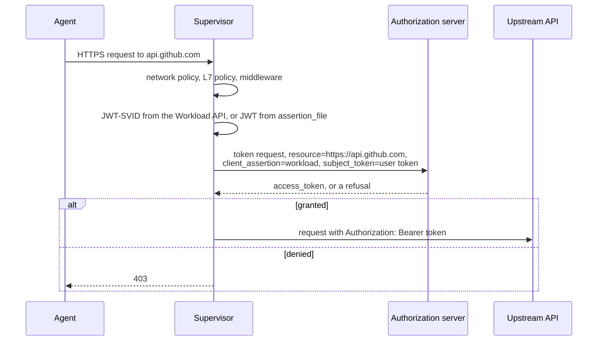

---
authors:
  - "@cmars"
state: draft
links:
  - (originating GitHub issue where maintainers assign this RFC number)
---

# RFC 0019 - Delegated Credential Grants

## Summary

A gateway names one OAuth 2.0 authorization server for a set of hosts. For each
inspected HTTPS request to one of those hosts, the supervisor asks that server
for a token, with the request origin as the RFC 8707 `resource`, and puts the
token in `Authorization`. If the server refuses, the supervisor denies the
request with HTTP 403.

The supervisor authenticates with a workload assertion in `client_assertion`.
The assertion is a SPIFFE JWT-SVID, or a JWT that the platform running the
sandbox writes to a file. With token exchange, the user-delegated
access token the agent sends in `Authorization` is the `subject_token`. Where a
sandbox may go, and with which credential, is then decided by the authorization
server's own policy. It is not decided by OpenShell configuration.

The grant fails closed. Traffic to a selected host that OpenShell cannot
inspect is refused, and a supervisor that rejects the grant refuses every
request.

## Motivation

Provider `token_grant` already obtains tokens with a SPIFFE client assertion
and RFC 8693 token exchange. Each grant is bound to the `endpoints` of one
provider profile, and its `audience` comes from the profile or from
`audience_overrides`. A new upstream API therefore needs a profile edit: a new
endpoint and a new audience mapping, pushed to every gateway. See
[Dynamic Token Grants](../../docs/how-it-works/providers/profiles.mdx).

Organizations that run many gateways want one authorization server to own this
decision. An administrator adds a dependency to an application in the
authorization server (for example, Keycard), and every OpenShell sandbox that
authenticates as that application can reach the new resource with a
server-issued credential. Revoking the dependency revokes access on the next
grant. OpenShell keeps enforcing network policy, but the credential and the
allow/deny decision for a resource come from one place.

Supervisor middleware ([RFC 0009](../0009-supervisor-middleware/README.md))
cannot do this. It runs before credential injection and may not write
credential headers. RFC 0009 reserves credential-visible hooks for in-process
built-ins.

Without this change, every new upstream needs a profile change on every
gateway. The authorization server cannot deny a request that the profile
selected.

## Non-goals

- Replacing network policy. Network policy still admits the connection first.
  The grant is a second gate, not an allow-all rule.
- A credential-writing hook for external middleware. The supervisor makes the
  OAuth call itself; the authorization server never sees request content.
- Per-sandbox or per-policy grant configuration. There is one grant per
  gateway, set in gateway configuration.
- Path-scoped resources. The resource is the request origin.
- A stored user token on the gateway as the subject. Provider `token_exchange`
  grants already do that.
- The MXC host proxy, which runs in the driver, not the supervisor.

## Proposal

### Configuration

The operator configures the grant once in `gateway.toml`:

```toml
[openshell.supervisor.delegated_grant]
token_endpoint = "https://auth.example.com/oauth/token"
assertion_source = "file"               # or "spiffe"
assertion_file = "/var/run/secrets/openshell/assertion.jwt"
grant_type = "token_exchange"           # or "client_credentials"
include_hosts = ["api.github.com", "**.example.com"]
exclude_hosts = ["status.example.com"]
scopes = []
```

The gateway validates the section at startup and in config preflight. It sends
the grant to every supervisor as `DelegatedCredentialGrant`, field 18 of
`GetSandboxConfigResponse` and `SandboxConfigSnapshot`. The grant is part of
the config revision, so supervisors notice a change after the gateway restarts.
Each sandbox instance in a supervisor installs its own copy of the grant.

### Request flow



The grant runs where provider token grants run today: after network policy,
L7 policy, and request middleware, and before static credential placeholders
are resolved. It applies to inspected relays, to TLS-terminated passthrough
relays, and to forward-proxy requests.

For a request whose host matches the grant:

- The resource is the origin. The default port is omitted:
  `https://api.github.com`, `https://api.example.com:8443`.
- The workload assertion is always `client_assertion`.
- `client_credentials` sends nothing else: the sandbox acts as itself.
- `token_exchange` sends the agent's bearer token from `Authorization` as
  `subject_token`, typed by `subject_token_type`, which defaults to
  `urn:ietf:params:oauth:token-type:access_token`. A request without exactly
  one `Authorization: Bearer` header is denied without a token request.
- Every `Authorization` header is replaced with `Bearer <token>`.
- Every request gets a new token request with a newly fetched assertion. The
  supervisor does not cache tokens or assertions, so every request gets the
  authorization server's current decision. The authorization server owns any
  caching.
- A plaintext request is denied with 403. A delegated token is never sent in
  cleartext.

### Denials

The motivating authorization server answers every refusal on its token
endpoint with HTTP 400 and a standard OAuth `error`. An `https://` token
endpoint answering 400, 401, or 403 with one of these codes is a denial:

| `error` | Meaning | Failure kind |
|---|---|---|
| `access_denied` (RFC 6749) | Policy refused the request, including a missing dependency | `access_denied` (new) |
| `invalid_target` (RFC 8707) | The resource is not registered | `access_denied` |
| `unauthorized_client` (RFC 6749) | The client may not use this grant | `access_denied` |
| `invalid_grant` (RFC 6749) | The subject token is invalid or expired, or the user is unknown | `access_denied` |
| `insufficient_authorization` | The user has not authorized the resource | `provider_authorization_required` |

The supervisor answers a delegated denial with an empty 403, or a JSON 403 on
the forward proxy, and the `x-openshell-request-id` header. Every other failure
keeps the existing generic 502. A plaintext token endpoint cannot authenticate
a denial, so the same error from it is `unclassified`.

Provider token grants also use this classification, but still answer 502.

### Failing closed

The grant is a gate, so every path that could skip it is closed:

- **Uninspected traffic.** The proxy refuses a `tls: skip` tunnel, non-HTTP
  TCP, or transparent TCP to a selected host, with a High detection finding.
  Only HTTP that the supervisor parses can receive the grant's decision.
- **Rejected grant.** If the supervisor rejects the grant the gateway sent, it
  does not keep the previous one, because the new grant may select more hosts.
  It refuses every request and every uninspected connection with a
  configuration failure until it installs a valid grant.
- **Grant changes.** Each request reads the installed grant, so a change
  applies to the next request on every open keep-alive connection.
- **Startup.** The supervisor installs the grant from its first configuration
  before the proxy accepts connections. SPIRE issues a new supervisor pod's
  SVID a few seconds after the pod starts, so a fetch that finds no identity
  yet retries for up to 10 seconds before the request fails.

### Header ownership

On selected hosts the delegated grant owns `Authorization`. A provider grant for
`Authorization` on the same request is not acquired. Otherwise a user-attached
provider could override the authorization server's denial. Provider grants for
other headers are still acquired. A denial stops every grant for the request.

### Workload assertions

`spiffe` fetches a JWT-SVID from the sandbox instance's Workload API socket, as
provider grants do. The audience defaults to the issuer derived from
`token_endpoint`.

`file` reads a JWT from `assertion_file`, an absolute path in the supervisor's
file system. The platform that runs the sandbox obtains the JWT and keeps the
file current. Any issuer the authorization server trusts works: a Kubernetes
projected service account token, an AWS STS `GetWebIdentityToken` result, or a
CI job's OIDC token. OpenShell does not call a vendor API.

The supervisor reads the file on every grant request, so a replaced token
applies to the next grant request. The supervisor checks only that the file
holds a JWT of at most 64 KiB with an `exp` claim that has not passed. The
authorization server verifies the signature and audience. A missing,
unreadable, or expired file is `unavailable`. A file without a JWT or `exp` is
a configuration failure. Both answer 502.

### Observability

- `ConfigStateChange` when a supervisor installs, removes, or rejects a grant.
  A rejection is High severity.
- `DetectionFinding`, High, for refused uninspected traffic to a selected
  host.
- `HttpActivity` Allowed, Informational, for an issued grant.
- `HttpActivity` Denied, Medium, for a denial or failure, with the request ID.

No token, assertion, or authorization server error text is logged.

## Implementation plan

The change is opt-in. A gateway without the section behaves as before.

1. Protocol: `DelegatedCredentialGrant` and its enums, and the config field.
2. Core: `resource` support in the OAuth client and the `access_denied`
   failure kind.
3. Gateway: config section, validation, preflight, config delivery and
   revision.
4. Supervisor: install the grant at startup, before the proxy accepts
   connections, and on each config update. Integrate it into the shared grant
   injection path, map denials to 403, and refuse uninspected traffic to
   selected hosts.
5. Docs: gateway configuration reference and the failure code table.
6. Tests: unit tests for config validation, revision hashing, assertion file
   reads, OAuth form fields, and injection outcomes. An e2e test
   against a local authorization server with a SPIFFE assertion is follow-up
   work.

## Risks

- **The authorization server is on the request path.** Every request to a
  selected host waits on a token request. An outage is a 502 for every such
  request. The authorization server must handle one token request per
  upstream request.
- **The assertion file is a credential.** Anything that can read the file can
  authenticate as the workload until the JWT expires. The file must be readable
  by the supervisor and not by the agent.
- **Shared file identity.** The authorization server sees whatever subject the
  file's issuer chose. If the platform writes the same JWT for every sandbox,
  the authorization server cannot tell sandboxes apart.
- **Classification of standard errors.** Treating `access_denied` and
  `invalid_target` as denials changes the reported code for provider grants
  that see these errors, from `unclassified` to `access_denied`. A gateway
  older than the supervisor rejects the new code in endpoint status reports.
- **Header takeover.** Selecting a host that agents already reach with their
  own `Authorization` breaks those clients, by design.
- **The agent's token reaches the authorization server.** With token
  exchange, the bearer token the agent sends to a selected host goes to the
  configured token endpoint as `subject_token`, not to the host. An agent
  that sends a credential meant for the upstream itself leaks that credential
  to the authorization server.
- **A rejected grant takes the sandbox offline.** The gateway and supervisor
  validate the grant with the same code, so a rejection needs a version skew.
  When it happens, every request fails until the configuration is fixed.
- **Tunnels opened before a grant change.** A raw tunnel to a host that a new
  grant selects stays open until it closes. The gate runs when a tunnel opens.

## Alternatives

### External credential middleware

Add a credential-visible phase to supervisor middleware, where a service
returns allow/deny plus a credential. This reverses an RFC 0009 decision. It
also gives an external service a credential-writing role and the request
content. A plain OAuth contract keeps the authorization server out of the data
path and lets any compliant server work.

### Wildcard provider profiles

Allow wildcard endpoints and a derived audience in provider profiles. The grant
would still be per provider and per sandbox, it would still be attached by
users, and it could not own `Authorization` against other providers.

### Do nothing

Keep per-profile endpoints. Every new upstream needs a configuration change on
every gateway, and the authorization server cannot deny a selected request.

## Prior art

- **RFC 8693 and RFC 8707.** Token exchange with resource indicators lets an
  authorization server issue audience-restricted tokens per resource. The
  supervisor uses the standard parameters.
- **Web identity token files.** AWS SDKs read `AWS_WEB_IDENTITY_TOKEN_FILE`
  and pass its contents to `AssumeRoleWithWebIdentity`
  ([AWS docs](https://docs.aws.amazon.com/sdkref/latest/guide/feature-assume-role-credentials.html)).
  The kubelet writes projected service account tokens to a file and rotates
  them when they are older than 80% of their TTL. The application reloads the
  file ([Kubernetes docs](https://kubernetes.io/docs/tasks/configure-pod-container/configure-service-account/)).
  `assertion_file` follows the same contract.
- **Envoy `ext_authz`.** It delegates the allow/deny decision to an external
  service on the hot path. This proposal does the same through an OAuth token
  request, and adds the credential.
- **OpenShell provider token grants.** The failure classification, request
  ID, and header injection are reused.

## Open questions

- **Actor token.** Should `token_exchange` also send the workload assertion as
  `actor_token`, so the issued token records the sandbox in `act`?
- **Provider grant denials.** Should a provider grant's `access_denied` also
  answer 403?
- **Path-scoped resources.** Should the resource include a path prefix for
  authorization servers that register resources below the origin?
