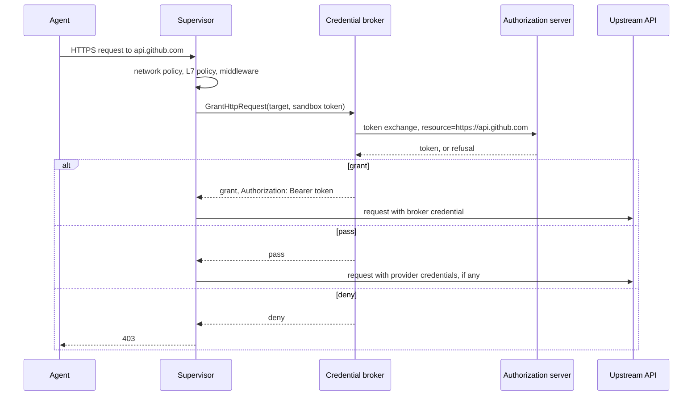

---
authors:
  - "@cmars"
state: draft
links:
  - (originating GitHub issue where maintainers assign this RFC number)
---

# RFC NNNN - Credential Brokers

## Summary

A credential broker is an operator-run gRPC service that decides the credential
for each inspected HTTP request a sandbox sends to a selected host. The
supervisor calls the broker at the credential injection step. The broker
answers with one of three decisions:

- `grant`: replace named headers or query parameters with broker-issued values.
- `pass`: send the request without a broker credential. Provider credentials
  still apply.
- `deny`: refuse the request with HTTP 403.

Only the broker talks to the authorization server. A broker for Keycard, or for
any OAuth 2.0 authorization server, performs the RFC 8693 token exchange with
an RFC 8707 resource on its own side of the contract.

## Motivation

An organization that runs many OpenShell gateways, each hosting many sandboxes,
wants one central authority to decide which credential a workload gets for a
resource on each request, or whether it gets one at all. With that authority,
provisioning, revocation, and upstream secret rotation apply to every gateway
on the next request. The existing extension points do not provide it:

- Credential drivers run on the gateway at sandbox creation. Credentials must
  be known before the sandbox starts.
- Supervisor middleware ([RFC 0009](../0009-supervisor-middleware/README.md))
  runs before credential injection. It cannot read or write credential headers.
- Provider token grants call an OAuth token endpoint, but each grant is bound
  to the endpoints and audience of one provider profile on each gateway.

Authorization servers differ in how they identify workloads, which grant types
they use, and how they report a refusal. The central authority also needs
three answers: issue a credential, allow the request without one, or refuse it.
An OAuth token endpoint has only two.

A typed extension contract keeps authorization server logic out of OpenShell.
OpenShell keeps inspection, policy, workload identity, header placement, and
failing closed. The broker owns the authorization server protocol.

### Use cases

- An administrator adds `api.linear.app` in the authorization server. The
  broker grants a token for it on the next request, with no gateway change.
- The authorization server revokes a workload's access to GitHub. The broker
  denies the workload's next GitHub request with 403.
- The broker exchanges the agent's bearer token for a token scoped to the
  target API, so the upstream API sees the user.
- The broker answers `pass` for hosts it does not govern. The operator can
  select every host without breaking traffic to those hosts.

## Non-goals

- Replacing network policy. Policy still admits the connection and request
  before the broker runs.
- Request bodies or arbitrary headers. The broker sees the request target and,
  when enabled, the agent's `Authorization` header.
- Per-sandbox or per-policy brokers. There is one broker per gateway, set by
  the operator.
- Credentials for traffic OpenShell does not parse as HTTP.
- An OAuth client in the supervisor.

## Proposal

### Configuration

The operator registers the broker in `gateway.toml`:

```toml
[openshell.supervisor.credential_broker]
name = "keycard"
grpc_endpoint = "https://credential-broker.openshell.svc:8443"
tls_ca_cert_path = "/etc/openshell/certs/broker-ca.pem"
audience = "urn:openshell:extension:credential-broker:keycard"
timeout = "1s"
include_hosts = ["**"]
exclude_hosts = ["status.example.com"]
forward_authorization = true
```

| Field | Meaning |
|---|---|
| `name` | Diagnostic name. |
| `grpc_endpoint` | `https://` endpoint reachable from every supervisor. `http://` requires `allow_insecure_transport = true`. |
| `tls_ca_cert_path` | Optional private CA for the broker's certificate. |
| `audience` | Extension token audience. Defaults to `urn:openshell:extension:credential-broker:<name>`. |
| `timeout` | Per-call deadline, 10 ms to 30 s. Defaults to `1s`. |
| `include_hosts` | Required. Hosts whose requests go to the broker, in network policy host syntax. |
| `exclude_hosts` | Optional. Takes precedence over `include_hosts`. |
| `forward_authorization` | Send the agent's `Authorization` header values to the broker. Defaults to `false`. |

At startup the gateway connects to the broker, calls `Describe`, and checks
peer metadata and `expected_audience`, as it does for middleware. It refuses to
start if the broker is unavailable or incompatible.
`openshell-gateway config preflight` runs the same checks. Changing the section
requires a gateway restart.

The gateway sends the registration to every supervisor in
`GetSandboxConfigResponse`. Sandbox policy does not select the broker, so a
sandbox user cannot detach it.

### Identity and transport

The broker uses the extension authentication described in
[Authenticating Extensions](../../docs/extensibility/overview.mdx). Each call
has a gateway-signed bearer token with `caller_kind = supervisor` and the
calling `sandbox_id`. The supervisor gets the token from `RefreshSandboxToken`,
as it does for middleware services. The broker MUST authorize on the token's
claims. Fields in the request message are for audit only.

The supervisor does not need a SPIFFE socket, an assertion file, or any
platform-specific identity. The broker decides how to prove the sandbox's
identity to its authorization server. See
[Example: an OAuth broker](#example-an-oauth-broker).

### Contract

```proto
package openshell.credential_broker.v1;

service CredentialBroker {
  // Describe returns the broker manifest. The gateway calls it at startup.
  rpc Describe(BrokerDescribeRequest) returns (BrokerManifest);

  // GrantHttpRequest decides the credential for one inspected HTTP request.
  rpc GrantHttpRequest(HttpCredentialRequest) returns (HttpCredentialResult);
}

message BrokerDescribeRequest {
  openshell.extension.v1.PeerMetadata gateway = 1;
}

message BrokerManifest {
  string name = 1;
  string expected_audience = 2;
  openshell.extension.v1.PeerMetadata extension = 3;
}

message HttpCredentialRequest {
  // Correlates the call with the workload response and supervisor logs.
  string request_id = 1;
  // Audit context. Authorize on the extension token's sandbox_id.
  string sandbox_id = 2;
  string method = 3;
  // "https" or "http".
  string scheme = 4;
  string host = 5;
  uint32 port = 6;
  // Request path without the query string.
  string path = 7;
  // The agent's Authorization header values, in wire order, as the agent
  // sent them. Empty unless the registration sets forward_authorization.
  repeated string authorization = 8;
}

message HttpCredentialResult {
  oneof decision {
    CredentialGrant grant = 1;
    CredentialPass pass = 2;
    CredentialDeny deny = 3;
  }
}

message CredentialGrant {
  repeated CredentialPlacement placements = 1;
}

message CredentialPlacement {
  oneof target {
    string header = 1;
    string query_parameter = 2;
  }
  string value = 3;
}

message CredentialPass {}

message CredentialDeny {
  DenyReason reason = 1;
}

enum DenyReason {
  DENY_REASON_UNSPECIFIED = 0;
  DENY_REASON_ACCESS_DENIED = 1;
  DENY_REASON_AUTHORIZATION_REQUIRED = 2;
}
```

The extension family's base capability is
`openshell.credential-broker.contract`, protocol `1.0`.

The request does not include the query string, the body, or any header other
than `Authorization`. `authorization` holds the header as the agent sent it,
before placeholder resolution, so the broker never receives a credential that
OpenShell manages.

### Request flow



The supervisor calls the broker at the credential injection step. The call
comes after network policy, L7 policy, and request middleware, and before
provider token grants and static placeholder resolution. It covers inspected
relays, TLS-terminated passthrough, and the forward proxy.

- `grant`: each placement replaces every instance of its header or query
  parameter. The supervisor skips provider token grants and placeholders for
  those targets, and applies provider credentials for other targets. A grant
  for an `http` request is a broker error. The supervisor never sends a broker
  credential in cleartext.
- `pass`: the supervisor applies provider credentials as it does today.
- `deny`: the supervisor answers 403 with `x-openshell-request-id`, or a JSON
  403 on the forward proxy. It does not acquire provider credentials.

The supervisor validates the result before it changes the request. Header names
must be valid HTTP tokens. The supervisor rejects placements on routing,
framing, hop-by-hop, `Connection`-nominated, and `x-openshell-*` headers.
Values must not contain control characters. A result has at most 8 placements
of at most 8 KiB each. An invalid result is a broker error.

The supervisor does not cache results, so every request gets the broker's
current decision. The broker caches upstream tokens if it wants to.

### Failures

The broker fails closed. It has no `on_error` setting.

| Outcome | Workload response | Failure code |
|---|---|---|
| `deny`, `ACCESS_DENIED` or unspecified | 403 | `access_denied` (new) |
| `deny`, `AUTHORIZATION_REQUIRED` | 403 | `provider_authorization_required` |
| gRPC `UNAVAILABLE`, `RESOURCE_EXHAUSTED` | 502 | `unavailable` |
| gRPC `DEADLINE_EXCEEDED`, or the `timeout` expires | 502 | `timeout` |
| gRPC `UNAUTHENTICATED`, `PERMISSION_DENIED` | 502 | `workload_identity_rejected` |
| gRPC `INVALID_ARGUMENT`, `FAILED_PRECONDITION` | 502 | `configuration_error` |
| Invalid result, or any other status | 502 | `unclassified` |

These are the [token grant failure](../../docs/how-it-works/providers/profiles.mdx)
codes, plus `access_denied`. OpenShell does not log gRPC status messages from
the broker.

The supervisor refuses traffic to a selected host that it cannot parse as HTTP:
`tls: skip` endpoints, raw TCP, and transparent TCP. It emits a High
`DetectionFinding` for each refusal. Gateway policy validation warns when a
policy endpoint with `tls: skip` matches `include_hosts`.

If a supervisor cannot install the broker registration, it refuses every
request to every host, and every uninspected connection, until it installs a
valid one.

### Observability

- `ConfigStateChange` when a supervisor installs, replaces, or rejects the
  broker registration. A rejection is High.
- `HttpActivity` for each decision. `grant` and `pass` are Informational.
  `deny` and failures are Medium, with the request ID.
- `DetectionFinding`, High, for refused uninspected traffic to a selected host.

OpenShell does not log placement values, the agent's `Authorization` values, or
broker error text.

### Example: an OAuth broker

A reference broker in `examples/credential-broker-oauth` works with any OAuth
2.0 authorization server. For each call it:

1. Verifies the extension token and reads `sandbox_id`.
2. Authenticates to the authorization server as the sandbox, in one of two
   ways:
   - The authorization server trusts the gateway's JWKS. The registration's
     `audience` is the authorization server's issuer, and the broker forwards
     the extension token as `client_assertion`.
   - The broker is its own issuer. It signs a short-lived assertion with `sub`
     set to the sandbox, and the authorization server trusts the broker's
     signing key.
3. Sends an RFC 8693 token exchange with `resource` set to the request origin,
   and the forwarded `Authorization` bearer token as `subject_token`. Without a
   user token, it uses `client_credentials`.
4. Maps the response. A token is `grant`. `access_denied`, `invalid_target`,
   `unauthorized_client`, and `invalid_grant` are `deny ACCESS_DENIED`.
   `insufficient_authorization` is `deny AUTHORIZATION_REQUIRED`. A resource the
   authorization server does not govern is `pass`, using whatever signal that
   server provides.

Keycard can run this broker or ship its own.

## Implementation plan

The broker is opt-in. A gateway without the section behaves as before.

1. Add `proto/credential_broker.proto`, the registration message in
   `sandbox.proto`, and the `access_denied` failure code.
2. In the gateway, add config parsing and validation, the startup `Describe`
   call, preflight, delivery in sandbox config, and extension tokens for the
   broker audience in `RefreshSandboxToken`.
3. In the supervisor, add the broker client, install the registration before
   the proxy accepts connections, call the broker at the credential injection
   step, validate placements, map results to 403 and 502, and refuse
   uninspected traffic to selected hosts.
4. Add `docs/extensibility/credential-brokers.mdx`, and update the gateway
   configuration reference and the failure code table.
5. Add the OAuth reference broker with a smoke test, unit tests for result
   validation and failure mapping, and an e2e test with a stub broker that
   returns each decision.

## Risks

- Each request to a selected host waits for one gRPC call, and the broker may
  wait on its authorization server. A broker outage returns 502 for every
  selected request.
- The broker sees the target of every selected request and, with
  `forward_authorization`, the agent's bearer tokens. It can place any
  credential on those requests. Only the operator can configure it.
- Extension tokens are bearer tokens. A captured token can call the broker as
  that sandbox until the token expires, at most one hour after issue.
  Middleware extension tokens have the same limitation.
- `include_hosts = ["**"]` refuses every `tls: skip` and raw TCP endpoint.
  Operators must exclude those hosts.
- A grant replaces the agent's own header. Clients that send their own
  `Authorization` to a granted host stop working.
- The contract, the gateway section, and the failure mapping need versioning
  and maintenance.

## Alternatives

### Supervisor OAuth client

The supervisor sends OAuth token requests directly to an authorization server
named in gateway configuration. No extra service runs, and any
standards-compliant authorization server works without custom code. OpenShell
then owns assertion sources, grant types, OAuth error mapping, and Kubernetes
token projection. Every authorization server difference needs an OpenShell
change, and the supervisor cannot express `pass`.

### A middleware binding

Add an `http_request_credentials` binding to supervisor middleware. This reuses
registration, `Describe`, and transport. Sandbox policy attaches middleware,
and sandbox users can edit that policy. Middleware also allows `fail_open` and
chains of up to 10 stages. Allowing the binding would also break the RFC 0009
rule that external middleware never sees credential headers.

### A per-request credential driver call

Add a per-request RPC to `CredentialDriver`. Credential drivers run on the
gateway over a Unix socket. Every request would go from the supervisor to the
gateway to the driver, which puts the gateway on the request path.

### Do nothing

Each new upstream needs a provider profile change on every gateway, and
revocation waits for token expiry.

## Prior art

Envoy `ext_authz` sends request attributes to an external service. An OK
response can add or overwrite request headers, and a denial sets the response
status
([API reference](https://www.envoyproxy.io/docs/envoy/latest/api-v3/service/auth/v3/external_auth.proto)).
The broker contract has the same shape, limited to credential placement.

Kubelet image credential providers return registry credentials per image. The
plugin calls the cloud vendor API, and the kubelet calls the plugin through a
narrow contract
([Kubernetes docs](https://kubernetes.io/docs/tasks/administer-cluster/kubelet-credential-provider/)).
OpenShell uses the same split.

The broker reuses the gateway-signed extension tokens and peer metadata that
supervisor middleware and gateway interceptors use.

## Open questions

- Is "credential broker" the right name? Other candidates are "credential
  resolver", which collides with `CredentialDriver.ResolveCredentials`, "token
  grant service", which suggests tokens only, and "credential middleware",
  which suggests the RFC 0009 chain.
- Should the extension token or request include the sandbox's workspace,
  owner, or the policy that admitted the request? The authorization server may
  need them for per-user decisions.
- Should a grant include a TTL so the supervisor can reuse it for the same
  sandbox and origin? A TTL removes the call from most requests and makes
  revocation slower.
- Should a connection-level RPC let the broker allow or refuse a `tls: skip`
  tunnel, instead of refusing all of them?
- Should a gateway allow more than one broker with disjoint selectors?
